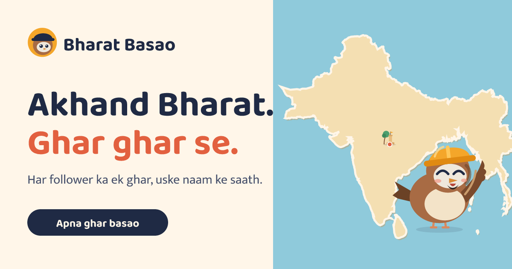

# Bharat Basao

**Akhand Bharat. Ghar ghar se.** An illustrated map of the undivided subcontinent that followers settle together, one named house at a time. A Velto Studios project.

Live: https://bharat-basao.vercel.app



## What it does

- **Interactive naksha.** A paper-cut style map of the undivided subcontinent with mountains, rivers and 98 cities. Search a city, tap a pin, zoom with + / − (or trackpad pinch / ctrl-scroll on desktop), drag to pan when zoomed. Labels avoid overlapping each other.
- **Zero Mile start.** Din 1 begins at Jansankhya 0, with one landmark built: the Zero Mile Chaupal at Nagpur, where Chiku Mistri stands.
- **Gali view.** Each city opens an illustrated street. Houses carry their owner's name and a sparrow on the roof; empty plots invite the first resident; a day/night switch lights windows and street lamps.
- **Ghar basao builder.** Name, city (from the map's list), style (Chhat wala, Khaprail, Chhatri), wall colour, door colour and decorations, with a live preview. The house appears in that city's gali straight away, and a 1080×1350 share card can be downloaded.
- **Nirmaan voting.** Pick which landmark should be built next (14 candidates). The public decision is made from Reel comments.
- **Chiku Mistri.** An original sparrow-builder mascot: blinks, follows the pointer, and cycles through moods and Hinglish lines when tapped.

### What is public and what is local

- **Public:** houses listed in `src/data/episode.ts` (`PUBLIC_HOUSES`, empty on Din 1, so Jansankhya is 0) and the built landmarks in `src/lib/landmarks.ts`. These change once per episode, from comments on @velto_studios Reels (followers only, one comment per person).
- **Local only:** a visitor's own house and landmark vote are saved in their browser (`localStorage`). The header shows them as "+1 aap". Nothing is sent to any server.

## Stack

Next.js 16 (App Router, static output) · React 19 · TypeScript (strict) · plain CSS · self-hosted fonts (`@fontsource/baloo-2`, `@fontsource/mukta`). No animation or UI library: all art is SVG generated from `src/lib/art.ts`, which the Reel renderer also uses.

## Run it

```bash
npm install
npm run dev        # http://localhost:3000
npm run verify     # typecheck + lint + production build
```

Node 20 or newer. No environment variables are required. `NEXT_PUBLIC_SITE_URL` (see `.env.example`) only sets the Open Graph base URL.

## Deployment and source of truth

| Role | Where |
|---|---|
| Source of truth (all edits go here) | **github.com/velto-studios/bharat-basao** (`main`) |
| Deployment mirror | github.com/AradhyaDixit18/bharat-basao, updated automatically by `deploy/mirror-sync.yml` (copied into the mirror's `.github/workflows/`) every ~15 minutes, or on demand with "Run workflow" |
| Hosting | Vercel project `bharat-basao` (team "aradhu74's projects", Hobby), production at https://bharat-basao.vercel.app |

Why a mirror: the Vercel account signs in with a different GitHub account than the one that owns the Velto repository, and Vercel can only connect to repositories its own GitHub login can reach. The mirror is never edited by hand.

## Add an episode

1. Read the comments on the latest Reel (followers only, one comment per person).
2. Add each house to `PUBLIC_HOUSES` in `src/data/episode.ts` (`city` must match a name in `src/data/map.ts`).
3. Move the winning landmark from `WISHLIST` to `BUILT` in `src/lib/landmarks.ts`.
4. Bump `EPISODE.day` and commit to `main` of velto-studios/bharat-basao. The mirror syncs and Vercel deploys.

## Project structure

```
src/
  app/            layout, page, global styles
  components/     Experience (state), BharatMap, Gali, Builder, Chiku
  data/           map.ts (generated outline, cities, rivers), episode.ts (public houses)
  lib/            art.ts (all illustrations), landmarks.ts, geo.ts, store.ts, card.ts
scripts/          build-map.cjs + cities.json (regenerates src/data/map.ts)
public/           og.png, icon.svg
deploy/           mirror-sync.yml (deployment mirror workflow)
docs/             REFERENCE_ANALYSIS.md (research behind the concept)
```

## Credits and licences

- Illustrations, mascot (Chiku Mistri), copy and code: original work by Velto Studios, 2026.
- Coastline data: [Natural Earth](https://www.naturalearthdata.com/) 1:50m, public domain, via the `world-atlas` package.
- Fonts: Baloo 2 and Mukta, SIL Open Font License 1.1.

The map is a creative, imagined depiction for a community game. It is not a political or official boundary map.
